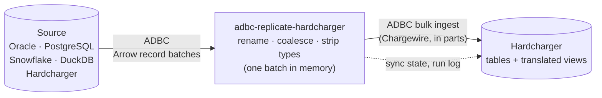

<p align="center">
  <a href="https://github.com/gizmodata/hardcharger">
    <picture>
      <source media="(prefers-color-scheme: dark)" srcset="https://raw.githubusercontent.com/gizmodata/adbc-replicate-hardcharger/main/docs/assets/hardcharger-banner-dark.png">
      
    </picture>
  </a>
</p>

# 🔁 adbc-replicate-hardcharger - by [GizmoData™](https://gizmodata.com)

**Config-driven ADBC-to-ADBC replication into [Hardcharger™](https://github.com/gizmodata/hardcharger): stream whole schemas from Oracle, PostgreSQL, Snowflake, DuckDB or another Hardcharger, with nothing materialized on the client.**

[](https://github.com/gizmodata/adbc-replicate-hardcharger)
[](https://github.com/gizmodata/adbc-replicate-hardcharger/actions/workflows/ci.yml)
[](https://pypi.org/project/adbc-replicate-hardcharger/)
[](https://pypi.org/project/adbc-replicate-hardcharger/)
[](https://pypi.org/project/adbc-replicate-hardcharger/)
[](https://github.com/gizmodata/hardcharger-adbc)
[](https://github.com/gizmodata/chargewire)
[](https://gizmodata.com)
[](https://github.com/gizmodata/adbc-replicate-hardcharger/pkgs/container/adbc-replicate-hardcharger)
[](#-run-it-on-kubernetes)
[](https://github.com/gizmodata/adbc-replicate-hardcharger/blob/main/LICENSE)
[](https://join.slack.com/t/gizmodatacommunity/shared_invite/zt-42jk7kdti-SJp7qk7d6XYCIKfBG~4HrA)

You describe *what* to replicate in a YAML file — which db_schemas, which tables and views
(with glob or regex filters), which columns to leave out or mask — and `adbc-replicate-hardcharger`
does the rest:



Data flows from the source driver to the target driver as an Arrow stream. Python never
touches individual rows, and the client holds about one batch at a time — replicating a
2-million-row Oracle table peaked at ~250 MB of client memory (most of it the Python
runtime and drivers) and ran at ~500k rows/s on a laptop.

It is derived from [adbc-replicate](https://github.com/gizmodata/adbc-replicate), GizmoData's
replication tool, and carries its history (view translation, masking, change detection, incremental
loads); this product targets Hardcharger, GizmoData's DuckDB 2.0 server, only.

## ✨ Features

- 🔌 **Sources:** Oracle ([adbc-driver-oracle](https://github.com/gizmodata/adbc-driver-oracle) — no Oracle Client needed), PostgreSQL, Snowflake, DuckDB, Hardcharger. **Target:** Hardcharger, loaded in parallel parts over [Chargewire](https://github.com/gizmodata/chargewire).
- 🎯 **Selection by pattern:** db_schemas, tables and views by case-insensitive glob (`SALES_*`) or `/regex/`, with excludes, per-rule target db_schema renames, and views that can be *materialized* as tables.
- 🔒 **Column filtering and masking:** exclude or allow-list columns; mask them with `null`, `hash` (salted SHA-256), `redact` or any SQL expression. **Masks run inside the source database**, so the raw values never cross the network — and a mask rule that matches nothing fails the run instead of silently leaking a typo'd column.
- 📸 **Consistent snapshots:** every table read from one point in time — `serializable` (one transaction) or `snapshot` (parallel workers sharing an Oracle SCN, a PostgreSQL exported snapshot, or a Snowflake time-travel timestamp). Foreign keys line up.
- ⏭️ **Only copy what changed:** a cheap metadata check where the source has one (Snowflake `LAST_ALTERED`), else a `COUNT` + content fingerprint computed *in the source* (`HASH_AGG`, `ORA_HASH`, `hashtextextended`). Unchanged tables cost one query.
- 🪟 **Views come along:** translated to DuckDB SQL with [sqlglot](https://github.com/tobymao/sqlglot) — Oracle `(+)` outer joins, `DUAL`, `ROWNUM`, `NVL`/`DECODE`, Snowflake `IFF`, view column lists — re-pointed at the replicated tables, created in dependency order, with hand-written overrides and an automatic "materialize instead" fallback.
- 🔤 **Name casing:** lower-case everything (the default), upper-case, or preserve — applied to tables, columns *and* the identifiers inside translated views.
- ⚡ **Parallel and atomic:** copy N tables at once; each table is swapped in within a transaction, so readers never see a half-loaded table.
- 🧪 **Trial runs:** `--row-limit 10` copies a sample of every table end to end; `plan` shows exactly what would happen without writing anything.
- 📒 **Run history in the target:** `run_log`, per-object results and sync state live in SQL tables next to the data.
- 🤖 **Automation-friendly:** emoji output for people, `--log-format json` for machines, distinct exit codes, a JSON Schema for the config, a container image and a Helm chart for scheduled runs.

## 🚀 Quick start (5 minutes, PostgreSQL → Hardcharger)

**1. Start a PostgreSQL source and a Hardcharger target, and add some data:**

```bash
docker run --detach --name replicate-demo-postgres --publish 5433:5432 \
  --env POSTGRES_PASSWORD=postgres postgres:16-alpine

docker run --detach --name replicate-demo-hardcharger --publish 31338:31337 \
  --env HARDCHARGER_ADMIN_USERNAME=hardcharger --env HARDCHARGER_ADMIN_PASSWORD=hardcharger \
  --env HARDCHARGER_DATABASE=/tmp/warehouse.duckdb ghcr.io/gizmodata/hardcharger:latest

# wait until PostgreSQL accepts connections (TCP: the image's first-start init server is socket-only)
until docker exec replicate-demo-postgres pg_isready --host=127.0.0.1 --quiet; do sleep 1; done

docker exec --interactive replicate-demo-postgres psql --quiet --username=postgres <<'SQL'
CREATE SCHEMA shop;
CREATE TABLE shop.customers (id int PRIMARY KEY, name text, email text, ssn text);
INSERT INTO shop.customers
  SELECT i, 'Customer ' || i, 'c' || i || '@example.com', '123-45-' || lpad(i::text, 4, '0')
  FROM generate_series(1, 1000) i;
CREATE TABLE shop.orders (id bigint PRIMARY KEY, customer_id int, amount numeric(12,2), ordered_at timestamptz);
INSERT INTO shop.orders
  SELECT i, i % 1000 + 1, round((random() * 500)::numeric, 2), now() - i * interval '1 hour'
  FROM generate_series(1, 100000) i;
CREATE VIEW shop.customer_totals AS
  SELECT c.id, c.name, sum(o.amount) AS total
  FROM shop.customers c JOIN shop.orders o ON o.customer_id = c.id
  GROUP BY c.id, c.name;
SQL
```

**2. Install** (the Hardcharger driver comes along; add the source drivers you need — `oracle`,
`postgresql`, `snowflake`, `duckdb`, or `all`):

```bash
pip install "adbc-replicate-hardcharger[postgresql]"
```

**3. Describe the replication** in `replicate.yaml` (`adbc-replicate-hardcharger init` writes a starter file):

```yaml
version: 1
name: shop-to-hardcharger

source:
  type: postgresql
  uri: postgresql://127.0.0.1:5433/postgres
  username: postgres
  password: ${PGPASSWORD}
  consistency: snapshot          # every table read at the same instant

target:
  type: hardcharger
  uri: hardcharger://127.0.0.1:31338?tls=false   # plain HTTP for this local demo; HTTPS by default
  username: hardcharger
  password: ${HARDCHARGER_PASSWORD}

objects:
  - db_schemas: [shop]

columns:
  - tables: [shop.customers]
    exclude: [email]
    mask:
      ssn: hash                  # hashed inside PostgreSQL: the raw value never leaves it

parallelism: 2
```

**4. Check it, then run it:**

```bash
export PGPASSWORD=postgres HARDCHARGER_PASSWORD=hardcharger

adbc-replicate-hardcharger test-connection --config replicate.yaml
adbc-replicate-hardcharger plan --config replicate.yaml
adbc-replicate-hardcharger run --config replicate.yaml
```

```text
✅ Source (postgresql): connected in 0.8s; catalog postgres, 2 db_schema(s) visible
✅ Target (hardcharger): connected in 0.3s; catalog warehouse, DuckDB v2.0.0-alpha48624
🗺️  Plan for shop-to-hardcharger: postgresql → hardcharger

📦 Tables (2)
  • shop.customers → shop.customers  [3 columns]  (excluded: email; masked: ssn (hash))
  • shop.orders → shop.orders  [4 columns]

🪟 Views (1)
  ✅ shop.customer_totals → shop.customer_totals

✨ 2 table(s) to copy, 1 view(s) ready
🚀 adbc-replicate-hardcharger 2.0.0: postgresql → hardcharger (catalog warehouse), run 3abe41f2-53c8-458c-afba-f385fb680e97
📸 Consistent read: exported snapshot 00000003-00000032-1
🔍 Discovering source objects…
🗺️  2 table(s) and 1 view(s) selected (0.0s)
📦 Copying tables (parallelism 2)…
  📦 Copying shop.customers → shop.customers (missing in target)
  ✅ shop.customers: 1,000 rows in 0.0s (excluded email)
  📦 Copying shop.orders → shop.orders (missing in target)
  ✅ shop.orders: 100,000 rows in 0.1s
📊 Tables: 2 copied (101,000 rows), 0 unchanged, 0 failed in 0.1s
🪟 Creating 1 view(s)…
  🪟 shop.customer_totals → shop.customer_totals
🪟 Views: 1 created, 0 unchanged, 0 failed
🏁 Run completed
⏱️  0.3s
```

Run it again and nothing is copied — both tables are fingerprinted in PostgreSQL and skipped:

```text
  ⏭️  shop.customers: unchanged (fingerprint, 1,000 rows)
  ⏭️  shop.orders: unchanged (fingerprint, 100,000 rows)
📊 Tables: 0 copied (0 rows), 2 unchanged, 0 failed in 0.1s
```

**5. Query the replica** (any Hardcharger client works; here, Python):

```python
import os

from adbc_driver_hardcharger import dbapi as hardcharger

with hardcharger.connect(uri="hardcharger://127.0.0.1:31338?tls=false", username="hardcharger",
                         password=os.environ["HARDCHARGER_PASSWORD"]) as conn, conn.cursor() as cur:
    cur.execute(operation="SELECT id, name, ssn FROM shop.customers ORDER BY id LIMIT 3")
    print(cur.fetchall())
    cur.execute(operation="SELECT name, total FROM shop.customer_totals ORDER BY total DESC LIMIT 3")
    print(cur.fetchall())
    cur.execute(operation="SELECT status, tables_copied, rows_copied FROM _adbc_replicate_hardcharger.run_log ORDER BY started_at")
    print(cur.fetchall())
```

```text
[(1, 'Customer 1', 'ed8558a632ff0bd6474c36a8bd16cb1381af61b57534295a4eda9f8a9a4d6a8e'), (2, 'Customer 2', 'b9749b...'), ...]
[('Customer 685', Decimal('29372.25')), ('Customer 449', Decimal('28880.03')), ('Customer 904', Decimal('28733.25'))]
[('completed', 2, 101000), ('completed', 0, 0)]
```

The order amounts are random, so your totals will differ; `run_log` has a row per run (the
first run, then the re-run that copied nothing).

Clean up with `docker rm --force replicate-demo-postgres replicate-demo-hardcharger`.

## 📦 Installation

| How | Command |
|---|---|
| PyPI (Python 3.11 – 3.15) | `pip install "adbc-replicate-hardcharger[all]"` |
| Container image (linux/amd64, linux/arm64) | `docker pull ghcr.io/gizmodata/adbc-replicate-hardcharger:latest` |
| Helm chart (scheduled CronJob) | `helm install my-replication oci://ghcr.io/gizmodata/charts/adbc-replicate-hardcharger --values values.yaml` |

The Hardcharger driver ([adbc-driver-hardcharger](https://github.com/gizmodata/hardcharger-adbc)) always
comes along; extras add the source drivers: `oracle`, `postgresql`, `snowflake`, `duckdb`, or `all`. On
Python 3.15, `all` leaves out `duckdb` until DuckDB publishes 3.15 wheels.

## 🧭 The command line

| Command | What it does |
|---|---|
| `adbc-replicate-hardcharger init [PATH]` | Write a starter config. |
| `adbc-replicate-hardcharger validate --config CONFIG` | Check a config without connecting to anything. |
| `adbc-replicate-hardcharger test-connection --config CONFIG` | Connect to the source and target and report what each sees. |
| `adbc-replicate-hardcharger plan --config CONFIG [--show-sql] [--format json]` | Show what a run would copy, the target names, excluded and masked columns, and whether each view translates. Connects to the source only. |
| `adbc-replicate-hardcharger run --config CONFIG` | Replicate. Options: `--full-refresh`, `--row-limit N`, `--tables 'HR.EMP*'` (repeatable), `--parallelism N`, `--skip-views`, `--log-format json`, `--quiet`. |
| `adbc-replicate-hardcharger test-notifications --config CONFIG` | Send a test message to every configured webhook. |
| `adbc-replicate-hardcharger schema` | Print the config's JSON Schema. |

`--config` has the short form `-c`, and `--quiet` has `-q`. `--env-file .env` (or `DOTENV_PATH`) loads environment variables first; existing variables win.

**Exit codes:** `0` completed · `1` failed (a table failed, or the run couldn't start) ·
`2` config or plan error (e.g. a mask rule that matches nothing) · `3` completed, but some
views couldn't be created · `130` / `143` interrupted by SIGINT / SIGTERM. Schedulers can
alert on anything non-zero.

**Stopping a run** (Ctrl-C, `kill`, or Kubernetes evicting the pod) cancels every statement in
flight, in every worker, so their target transactions roll back and no server session is left
holding locks; views are skipped, the run is logged as `interrupted` and notifications fire. A
second signal exits at once.

## 📝 The config

A config is a YAML (or JSON) document. Any string can reference the environment as
`${VAR}` or `${VAR:-default}` — substitution happens *after* YAML parsing, so a password
full of YAML syntax can't break the file, and a referenced variable that isn't set is an
error. Run `adbc-replicate-hardcharger schema` for the full JSON Schema.

ADBC terms are used throughout: a **catalog** is a database (Snowflake database, PostgreSQL
database, Oracle PDB, DuckDB attached database), a **db_schema** is a schema inside it (an
Oracle user/owner), and then tables and views.

### Choosing what to replicate

```yaml
version: 1
source:
  type: oracle
  uri: oracle://oracle.example.com:1521/ORCLPDB1
  username: ${ORACLE_USERNAME}
  password: ${ORACLE_PASSWORD}
target:
  type: hardcharger
  uri: hardcharger://hardcharger.example.com
  username: ${HARDCHARGER_USERNAME}
  password: ${HARDCHARGER_PASSWORD}
  catalog: erp                       # target catalog (default: the server's current one)

objects:
  # Rules are applied in order; the first rule that selects an object decides it.
  - db_schemas: [HR, "SALES_*"]      # globs are case-insensitive
    exclude_tables: ["*_BAK", "/^TMP_/"]   # /.../ is a regular expression
    views: ["*"]                     # the default; [] = no views
    materialize_views: ["V_HEAVY_*"] # copy these views' data as tables instead
  - db_schemas: [STAGING]
    tables: ["GL_*", ORDERS]         # only these tables from STAGING...
    views: []                        # ...and none of its views
    target_db_schema: "{db_schema}_raw"   # lands in staging_raw
```

`target_db_schema` takes a `{db_schema}` placeholder (quote it in YAML). If two objects
would land on the same target name, a copied **table** wins over a view — useful for
replacing a view with a table copied from elsewhere; references to the replaced object
inside other views are re-pointed automatically.

### Columns: exclude, allow-list, mask, rename

```yaml
columns:
  - tables: ["*"]                    # every selected table
    exclude: ["*_PASSWORD", "AUDIT_BLOB"]
  - tables: [HR.EMPLOYEES]           # DB_SCHEMA.TABLE; a pattern without a dot matches any db_schema
    mask:
      SSN: {strategy: hash, salt: "${MASK_SALT}"}   # salted SHA-256, hex
      SALARY: "null"                 # NULL, but keeps the column and its type
      PHONE: {strategy: redact, value: "XXX-XXX-XXXX"}
      EMAIL: {strategy: expression, sql: "REGEXP_REPLACE({column}, '^[^@]+', '***')"}
  - tables: [HR.BADGE_SCANS]
    include: [ID, EMPLOYEE_ID, SCANNED_AT]   # allow-list: nothing else is copied
  - tables: ["*"]
    fingerprint_ignore: [DBT_INVOCATION_ID, DBT_RUN_STARTED_AT]   # copied, but not "a change"
  - tables: [ERP.QUOTE_LINES]
    rename: {ROW_ID: source_row_id}  # exact source name -> target name, used as written
```

Every mask is evaluated **in the source database** as part of the SELECT, so the raw value
never leaves it. `expression` masks are written in the *source's* SQL dialect; `{column}`
is replaced by the quoted column name. A view that references an excluded column fails to
create (and is reported) rather than exposing it.

`rename` is for names the target can't take: a DuckLake catalog reserves `row_id`,
`begin_snapshot` and `end_snapshot` while data inlining is on, and on a PostgreSQL metadata
catalog names such as `session_user` and `current_date` currently fail
([duckdb/ducklake#1779](https://github.com/duckdb/ducklake/issues/1779)). Views that use a
renamed column's old name are reported as failed.

**Typos fail closed:** if an `exclude`, `include`, `mask` or `rename` entry matches no column of
any selected table, the run stops before copying anything:

```text
❌ column rules that match nothing (a typo here could leak a column):
  - columns[1].mask pattern 'SNN' (tables ['HR.EMPLOYEES']) matched no column of any selected table
Fix the pattern, or set fail_on_unmatched_column_rules: false.
```

To leave out a whole sensitive table, exclude it in `objects` (`exclude_tables: [EMPLOYEE_SSN]`).

### Consistency

| `source.consistency` | Meaning | Parallelism |
|---|---|---|
| `none` (default) | Each table is read as of its own query. | any |
| `serializable` | Every table is read in **one** transaction on one connection — the classic "consistent export". | 1 |
| `snapshot` | Every worker reads the **same point in time**: Oracle `AS OF SCN`, a PostgreSQL exported snapshot (`pg_export_snapshot`), Snowflake time travel (`AT(TIMESTAMP => …)`). | any |

Oracle notes: `snapshot` needs the `FLASHBACK` privilege on tables the user doesn't own,
and reads an exact SCN through `DBMS_FLASHBACK` — grant it with
`GRANT EXECUTE ON SYS.DBMS_FLASHBACK TO <user>` (as SYS). Without that it falls back to
`TIMESTAMP_TO_SCN(SYSTIMESTAMP)`, up to ~3 s old, and says so in the run output. A table
truncated or altered after the snapshot SCN can't be read as of it (ORA-01466), and a run
longer than the database's undo retention fails with ORA-01555; the error carries a hint
for both. PostgreSQL holds the snapshot's transaction open for the whole run.

### Change detection and refresh

With `refresh.mode: changed` (the default) a table is copied only when:

1. it's missing in the target, has no sync state, or its column selection/masks changed; or
2. its metadata says it changed (Snowflake base tables: `LAST_ALTERED`); or
3. its row count + content fingerprint, computed in the source, differs from the last run.

Tables whose types can't be fingerprinted (e.g. Oracle `LONG`, `XMLTYPE`) are copied every
run; `plan` lists them. `refresh.mode: full` (or `run --full-refresh`) copies everything.
Each copy is a `CREATE OR REPLACE` inside a transaction: readers see the old table until
the new one commits.


#### Incremental loads

```yaml
refresh:
  mode: incremental          # changed rows only, merged on the primary key
  detect_deletes: true       # default: also remove rows whose key is gone from the source
```

(For Oracle, set `source.consistency: snapshot`: the snapshot SCN is where the next run starts.)

With `refresh.mode: incremental`, a table that has a primary key gets only the rows that changed
since the last run, merged into the target with DuckDB `MERGE INTO` on the key (matching rows
updated, new ones inserted, by column name). With `detect_deletes`, each run also reads the
source's key column(s) and deletes target rows whose key no longer exists. Keys come from the
driver's ADBC catalog metadata (`GetObjects`), not a source-specific dictionary query; `plan`
shows `incremental on <key>` per table, or why a table gets whole-table copies instead (no
primary key, or a key column that is excluded or masked other than with `hash`).

How a source tells which rows changed:

- **Oracle:** `ORA_ROWSCN > <the previous run's snapshot SCN>`, read `AS OF` the current snapshot.
  `ORA_ROWSCN` is the commit SCN of a row's last change, so unlike a timestamp or sequence column
  it never misses a transaction that commits late (also on RAC, where sequence caches make IDs
  arrive out of order). Unless a table was created with `ROWDEPENDENCIES` it's tracked per
  block, so some unchanged rows come along; the merge makes that harmless.
- **Other sources (Snowflake, PostgreSQL, DuckDB)** can't name changed rows themselves (Snowflake
  change tracking is off by default and needs the table owner). For them, name a
  **watermark column**: a timestamp that every write stamps on the rows it inserts or updates,
  such as dbt's `DBT_RUN_STARTED_AT`. Each run reads the rows stamped after the previous run's
  highest value, minus `watermark_lookback_minutes` (for writers that commit out of stamp order),
  and merges them on the key.

```yaml
refresh:
  mode: incremental
  watermark_column: DBT_RUN_STARTED_AT
  watermark_lookback_minutes: 360   # default: re-read 6 h before the last stamp seen
  detect_deletes: false             # dbt merges never delete: check row counts instead (below)
  keys:                             # for tables whose source declares no primary key
    ANALYTICS.FACT_ORDERS: [ORDER_ID]                 # e.g. the dbt model's unique_key
    ANALYTICS.ORDER_LINES: [ORDER_ID, LINE_NUMBER]
  append:                           # keyless tables that only ever gain rows: insert, don't merge
    - ANALYTICS.WEB_EVENTS
```

`keys` supplies merge keys where the source has none, or overrides a declared one. Snowflake keys
are optional and never enforced, and dbt keeps a model's `unique_key` to itself. `append` is for
keyless tables that only grow, such as dbt incremental models without a `unique_key`, which dbt
`INSERT`s into. Their newly stamped rows are appended, with no lookback, since a re-read would
duplicate rows.

Without delete detection, each merge or append ends by comparing the target's row count with the
source's. A mismatch rolls the merge back and copies the table whole: that happens after a delete in
the source, after a dbt full refresh restamps every row of an append table, or when the merge key
turns out not to be unique among the changed rows.

The first incremental run copies each table whole (or confirms it unchanged) and records where
it stood; later runs merge. Tables without a usable key keep `changed`-mode behavior. Keep the
watermark for tables whose writes touch a few rows at a time: when every write restamps every row
(dbt `table` models, which are rebuilt whole), a merge rereads the whole table, while
`changed` mode would skip it when the fingerprint is unchanged.

### Views

Views are recreated in the target after the tables, in DuckDB SQL:

- definitions are read from the source catalog and translated with sqlglot; Oracle `(+)`
  joins become `LEFT JOIN`s, `OUTER/CROSS APPLY` become lateral joins, `FROM DUAL` is dropped,
  `WHERE ROWNUM <= n` becomes `LIMIT n`, and constructs with no faithful translation (e.g.
  PL/SQL functions) are reported, never silently changed;
- Oracle hierarchical queries (`START WITH` / `CONNECT BY [NOCYCLE]`, `PRIOR`, `LEVEL`,
  `SYS_CONNECT_BY_PATH`, `CONNECT_BY_ROOT`, `CONNECT_BY_ISLEAF`, `ORDER SIBLINGS BY`, `ROWNUM`
  as the depth-first row number, `START WITH ... AND ROWNUM = 1` for a single anchor, and
  `CONNECT BY LEVEL <= n` row generators) become `WITH RECURSIVE` queries;
  `MIN/MAX(...) KEEP (DENSE_RANK FIRST/LAST ORDER BY ...)` becomes `min_by`/`max_by`; `INSTR`
  with a start position (also negative: searching backward) or an occurrence is computed exactly;
  multi-column `UNPIVOT`, recursive `WITH`, `x = ALL (a, b)`, `ROWNUM = 1`, `FROM_TZ`,
  `NUMTODSINTERVAL`, `STANDARD_HASH` / `RAWTOHEX` and `OUTER APPLY (cte)` are translated too;
- Oracle's string semantics are kept: `||` and `CONCAT` treat NULL as an empty string (DuckDB's
  `||` returns NULL), an empty result is NULL, numbers and dates turn into text the way Oracle
  prints them (`1.50` → `1.5`, `0.5` → `.5`, a DATE as `DD-MON-RR`), and `SUBSTR`, `TRIM`,
  `LPAD`, `REPLACE`, ... follow Oracle's rules for positions, lengths and empty results;
- Oracle date semantics are kept: `CAST(x AS DATE)` keeps the time of day, `TRUNC(date)` and
  `TRUNC(date, 'MM')` become `DATE_TRUNC`, and `TO_CHAR` formats with an exact DuckDB
  equivalent (`YYYYMMDD`, `HH24:MI`, `DAY`, `fm0000000`, `fm999,990`, ...) are rewritten; the
  rewrites are checked value by value against Oracle in the integration tests;
- `SYSDATE`, `SYSTIMESTAMP` and `CURRENT_DATE` are the source server's wall-clock time, so they
  need `views.source_time_zone`; the plan warns if it doesn't match the server's clock;
- unqualified table references are qualified with the view's db_schema, references to
  replicated objects are re-pointed at their target names, and identifiers follow
  `naming.case`;
- views that depend on other views are retried until no more succeed;
- an unchanged definition (same SHA-256) isn't re-created.

```yaml
views:
  overrides_dir: ./view-overrides    # <DB_SCHEMA>.<VIEW>.sql: your own DuckDB SELECT, used instead
  on_failure: materialize            # or: report (default)
  source_time_zone: America/New_York # the source's clock, for SYSDATE & co (Oracle)
  source_pseudo_columns: "null"      # Oracle ORA_ROWSCN / ROWID / SYS_CONTEXT(...) in views: fail (default) | null
  sys_context_macros: true           # parameterized views (SYS_CONTEXT) also get a table macro
  functions:                         # your own source functions (e.g. PL/SQL), as DuckDB SQL
    # {1}, {2}, ... are the call's arguments by position, {p_name} a named one (p_name => x);
    # package functions are keyed PKG.FN
    BOM_FACTOR: >-
      CAST(coalesce(list_product(list_transform(string_split(substring({1}, 2), '/'),
      lambda q: coalesce(CAST(NULLIF(q, '') AS DOUBLE), 1))), 1) AS DECIMAL(38,10))
    # list the parameters so positional and named calls both work; RETURN DATE makes
    # "next_weekday(d) + 1" Oracle date arithmetic (days)
    NEXT_WEEKDAY(p_date) RETURN DATE: >-
      {p_date} + to_days(CASE isodow({p_date}) WHEN 5 THEN 3 WHEN 6 THEN 2 ELSE 1 END)
```

`SYS_CONTEXT(...)` reads as NULL with `source_pseudo_columns: "null"`: what Oracle returns in a
session that set no context, so "parameterized views" behave as if no parameter was passed. With
`sys_context_macros: true` such a view also gets a DuckDB table macro of the same name, with one
parameter per context attribute (default NULL), so the parameters can still be passed:

```sql
SELECT * FROM erp.invoices_as_of(cutoff_date := DATE '2025-12-31');
```

A view that calls any other source-only function can't be translated: rewrite the function in
`views.functions`, or list the view in `objects[].materialize_views` to copy its rows instead
(column rules still apply).

### Notifications: Slack or any webhook

```yaml
notifications:
  - url: ${SLACK_WEBHOOK_URL}          # a Slack incoming webhook; the URL is a secret
    when: [failure, view_errors]       # default; add success for a daily "all good"
  - url: ${OPS_WEBHOOK_URL}
    when: [failure, view_errors, success]
    format: json                       # the run summary as JSON, for any other receiver
    include_errors: false              # names and counts only (errors can quote source values)
```

When a run finishes, each webhook whose `when` matches the outcome is called: `failure`
(exit 1 or 2, including config, plan and connection errors), `view_errors` (exit 3) or
`success` (exit 0). The Slack message carries the outcome, table/row/view counts, the
duration, the consistent-read point and the first failures with their (clipped) errors. A
webhook that can't be reached is retried once and then reported as a warning; it never fails
the replication, and only the URL's host is ever printed. `adbc-replicate-hardcharger test-notifications
--config replicate.yaml` sends a test message to every webhook.

### Everything else

```yaml
naming:
  case: lower            # lower (default) | upper | preserve
refresh:
  mode: changed          # changed (default) | full | incremental
parallelism: 4           # tables copied at once
on_table_error: abort    # abort (default: skip views, fail the run) | continue
ingest:
  batch_rows: 65536      # coalesce small source batches up to this many rows...
  batch_bytes: 12582912  # ...and 12 MiB (keeps the server's insert buffers dense)
state:
  db_schema: _adbc_replicate_hardcharger   # where sync state and the run log live in the target
```

## 🗄️ Sources

<details>
<summary><b>Oracle</b> — via <a href="https://github.com/gizmodata/adbc-driver-oracle">adbc-driver-oracle</a> (no Oracle Client)</summary>

```yaml
version: 1
source:
  type: oracle
  uri: oracle://db.example.com:1521/ORCLPDB1
  username: ${ORACLE_USERNAME}
  password: ${ORACLE_PASSWORD}
  consistency: serializable
  unconstrained_number: decimal      # decimal (default) | double | string
  external_tables: include           # include (default) | exclude
  options:
    adbc.oracle.nne: required        # Native Network Encryption, fail closed
target:
  type: hardcharger
  uri: hardcharger://hardcharger.example.com
  username: ${HARDCHARGER_USERNAME}
  password: ${HARDCHARGER_PASSWORD}
objects:
  - db_schemas: [ERP]
```

- A `NUMBER` declared without precision would arrive as `float64` (lossy beyond 15
  digits); by default it's read as `NUMBER(38,10)` → `DECIMAL(38,10)`, rounded to 10
  fractional digits — a longer integer part fails loudly instead of losing data.
  `NUMBER(p,s)` keeps its exact precision; `DATE` becomes `TIMESTAMP`; LOBs stream inline.
- The user needs `SELECT` on what it replicates (plus `FLASHBACK` and `DBMS_FLASHBACK` for
  `consistency: snapshot`). It reads `ALL_TABLES`, `ALL_VIEWS`, `ALL_MVIEWS` and `ALL_TAB_COLUMNS`.
- Global temporary tables are skipped (their rows are private to the session that wrote
  them). External tables are copied like tables but read as they are now, since files have no
  SCN; `external_tables: exclude` leaves them out. `BFILE` columns (pointers to files on the
  database server) can't be read, and `LONG` / `LONG RAW` columns (deprecated; Oracle can't use
  them in expressions) aren't copied either: they are skipped, and the plan lists them. To keep a
  `BLOB` column without its bytes (so views selecting it still work), mask it: `"null"`.
- On 23ai and later, `GRANT SELECT ANY TABLE ON SCHEMA ERP` and `GRANT FLASHBACK ANY TABLE ON
  SCHEMA ERP` cover every current and future table in a schema.
- Any `adbc.oracle.*` driver option (TLS, wallets, NNE, batch sizes) goes in `options`.
</details>

<details>
<summary><b>PostgreSQL</b> — via adbc-driver-postgresql</summary>

```yaml
version: 1
source:
  type: postgresql
  uri: postgresql://pg.example.com:5432/app?sslmode=require
  username: ${PGUSER}
  password: ${PGPASSWORD}
  consistency: snapshot
  unconstrained_numeric: decimal     # decimal (default) | double | string
target:
  type: hardcharger
  uri: hardcharger://hardcharger.example.com
  username: ${HARDCHARGER_USERNAME}
  password: ${HARDCHARGER_PASSWORD}
objects:
  - db_schemas: [public, billing]
```

- `numeric(p,s)` becomes `DECIMAL(p,s)`; unconstrained `numeric` becomes `DECIMAL(38,10)`;
  `uuid`, `inet` and friends become text; `jsonb` becomes JSON text; arrays become lists.
- Partitioned tables are copied once (through the parent), materialized views as tables.
</details>

<details>
<summary><b>Snowflake</b> — via adbc-driver-snowflake (key-pair auth shown)</summary>

```yaml
version: 1
source:
  type: snowflake
  consistency: snapshot              # time travel: every table AT the same timestamp (not on shared databases)
  options:
    username: REPLICATOR
    adbc.snowflake.sql.account: ${SNOWFLAKE_ACCOUNT}
    adbc.snowflake.sql.role: REPLICATOR_ROLE
    adbc.snowflake.sql.warehouse: REPLICATOR_WH
    adbc.snowflake.sql.db: ANALYTICS
    adbc.snowflake.sql.auth_type: auth_jwt
    adbc.snowflake.sql.client_option.jwt_private_key_pkcs8_value: ${SNOWFLAKE_PRIVATE_KEY}
    # for an encrypted key (BEGIN ENCRYPTED PRIVATE KEY):
    # adbc.snowflake.sql.client_option.jwt_private_key_pkcs8_password: ${SNOWFLAKE_PRIVATE_KEY_PASSPHRASE}
target:
  type: hardcharger
  uri: hardcharger://hardcharger.example.com
  username: ${HARDCHARGER_USERNAME}
  password: ${HARDCHARGER_PASSWORD}
objects:
  - db_schemas: [MARTS, CORE]
  - catalog: RAW                     # Snowflake can read other databases on one connection
    db_schemas: [EVENTS]
    views: []
columns:
  - exclude: ["*COLUMN_SOURCES"]
    fingerprint_ignore: [DBT_INVOCATION_ID, DBT_RUN_STARTED_AT]
```

- Base tables are skipped by `LAST_ALTERED` alone; views and dbt-rebuilt tables by `HASH_AGG`.
- A shared (imported) database, such as `SNOWFLAKE_SAMPLE_DATA` or a Marketplace listing, has
  no time travel, so `consistency: snapshot` is refused at plan time; use `consistency: none`
  for it.
- `result_queue_size` (4) and `prefetch_concurrency` (2) keep the driver's memory flat.
</details>

<details>
<summary><b>DuckDB</b> — a local database file</summary>

```yaml
version: 1
source:
  type: duckdb
  path: ./analytics.duckdb
target:
  type: hardcharger
  uri: hardcharger://hardcharger.example.com
  username: ${HARDCHARGER_USERNAME}
  password: ${HARDCHARGER_PASSWORD}
objects:
  - db_schemas: [main]
```

- DuckDB's Arrow export changes three types without an error: `TIMETZ` (`TIME WITH TIME ZONE`) arrives
  as `TIME` without its UTC offset, and `BIT` and `BIGNUM` arrive as their internal bytes (`BLOB`). So
  the plan refuses a table with such a column (alone or nested, e.g. `TIMETZ[]`), before anything is
  copied, and names each column. Copy it as text with a mask expression, or leave it out:

  ```yaml
  columns:
    - tables: [main.events]
      mask:
        local_time: {strategy: expression, sql: "CAST({column} AS VARCHAR)"}
      exclude: [flags]
  ```

  A view with such a column isn't materialized by `views.on_failure: materialize` unless it is masked
  the same way.
- `UUID`, `JSON` and `ENUM` arrive as text, `HUGEINT` as `DECIMAL(38,0)`.
</details>

<details>
<summary><b>Hardcharger</b> — another Hardcharger server, via adbc-driver-hardcharger</summary>

```yaml
version: 1
name: production-to-staging
source:
  type: hardcharger
  uri: hardcharger://hardcharger.example.com
  username: ${HARDCHARGER_USERNAME}
  password: ${HARDCHARGER_PASSWORD}
  consistency: serializable          # none (default) | serializable
target:
  type: hardcharger
  uri: hardcharger://staging.hardcharger.example.com
  username: ${STAGING_USERNAME}
  password: ${STAGING_PASSWORD}
objects:
  - db_schemas: [public, billing]
```

- A large result arrives split into partitions read at once. `consistency: serializable` reads every
  table in one transaction; `snapshot` isn't offered (DuckDB can't share a snapshot between
  connections). Views are read from `duckdb_views()`, and change detection fingerprints in the server,
  as for a DuckDB file.
- Hardcharger sends `HUGEINT`/`UHUGEINT` as `DECIMAL(38,0)` and refuses a value of 39 digits or more
  instead of sending it wrong; copy such a column as text with
  `mask: {COL: {strategy: expression, sql: "CAST({column} AS VARCHAR)"}}`.
- As from a DuckDB file, `UUID`, `JSON` and `ENUM` arrive as text and `HUGEINT` as `DECIMAL(38,0)`, and
  `TIMETZ`, `BIT` and `BIGNUM` columns are refused unless masked or excluded (see the DuckDB source).
</details>

## 🏎️ The target: Hardcharger

[Hardcharger](https://github.com/gizmodata/hardcharger) is GizmoData's DuckDB 2.0 server, spoken to over
the [Chargewire](https://github.com/gizmodata/chargewire) protocol (HTTP) through
[adbc-driver-hardcharger](https://github.com/gizmodata/hardcharger-adbc). `target.type` is
`hardcharger`, the default and the only target type:

```yaml
target:
  type: hardcharger                               # the default; may be left out
  uri: hardcharger://hardcharger.example.com      # HTTPS, port 31337
  username: ${HARDCHARGER_USERNAME}
  password: ${HARDCHARGER_PASSWORD}
  catalog: warehouse                              # target catalog (default: the server's current one)
  tls_root_certs: /etc/ssl/certs/private-ca.pem   # only for a server certificate from a private CA
  ingest_parts: 8                                 # the default
  checkpoint: true                                # the default: CHECKPOINT before and after a load
```

- **Connections.** `hardcharger://host` is HTTPS on port 31337; `hardcharger://host:port` picks another
  port and `hardcharger://host?tls=false` is plain HTTP (development only). `tls_root_certs` trusts a
  private CA (a PEM file), `tls_skip_verify` skips verification (development only), and any
  `adbc.hardcharger.*` / `adbc.chargewire.*` driver option goes in `options`.
- **Loads.** Each table's rows go up as `ingest_parts` parts at once, each over its own connection
  (Chargewire partitioned ingest), into the run's target transaction like any other statement: readers
  keep the previous copy until it commits, and a failed or interrupted load rolls back, parts and all.
  Rows land in no defined order; `ingest_parts: 1` sends one stream in the source's order.
- **Incremental loads** merge with DuckDB 2.0's `MERGE`, which refuses several changed rows with one key;
  adbc-replicate-hardcharger counts repeated keys first and copies such a table whole. `CHECKPOINT`
  needs the admin role (a failure is only a warning).
- **Types** are checked value by value against a real server by the test suite: Hardcharger stores
  every Arrow type exactly as DuckDB's own ingest does, including `TIME_NS`, `INTERVAL`, `UNION`, `UUID`
  and `JSON` (as Arrow extension types), `decimal32`/`decimal64`, binary views, fixed-size binary and list
  views; an all-NULL Arrow `null` column becomes `VARCHAR`. Arrow `float16` and `decimal256` have no
  DuckDB column and are refused.
- **Known limits (Hardcharger 0.3.0):**
  - the server refuses any SQL string literal containing `{` or `*` (a JSON object, a regular expression
    such as `'^[0-9]{3}$'`, `RPAD(x, 6, '*')`) as a credential path, so a translated view or a mask
    expression with one fails there and is reported. Bound parameters are not affected.
  - a view in catalog `x` can't read a db_schema also named `x`, even fully qualified ("Ambiguous
    reference to catalog or schema"); tables copy, and such views are reported. Name the target catalog
    differently from the db_schemas it holds.

## ☸️ Run it on Kubernetes

The Helm chart runs `adbc-replicate-hardcharger run` as a CronJob (`concurrencyPolicy: Forbid`, so runs
never overlap, and `karpenter.sh/do-not-disrupt` so autoscalers don't evict a run mid-copy).
The config goes in `values.config`; secrets come from an existing Secret as environment
variables:

```bash
kubectl create secret generic erp-replication-env \
  --from-literal=ORACLE_PASSWORD=... --from-literal=HARDCHARGER_PASSWORD=...

helm install erp-replication oci://ghcr.io/gizmodata/charts/adbc-replicate-hardcharger --values values.yaml
```

```yaml
# helm values.yaml
schedule: "15 2 * * *"
timeZone: America/Chicago
existingSecret: erp-replication-env
extraArgs: ["--log-format", "json"]
config:
  version: 1
  name: oracle-to-hardcharger
  source:
    type: oracle
    uri: oracle://oracle.internal:1521/PROD
    username: REPLICATOR
    password: ${ORACLE_PASSWORD}
    consistency: serializable
  target:
    type: hardcharger
    uri: hardcharger://hardcharger.internal
    username: replicator
    password: ${HARDCHARGER_PASSWORD}
  objects:
    - db_schemas: [ERP]
```

Run it now with `kubectl create job --from=cronjob/erp-replication-adbc-replicate-hardcharger manual-1`.

Two alternatives suit a deploy repo that keeps one config file and one `.env` for both the CLI
and the cluster. `configFile` takes the config file as it is, comments included, instead of
`values.config`. `dotenv` takes a whole dotenv file, which the chart stores in a Secret, mounts
at `/secrets/.env` and loads through `DOTENV_PATH`. Variables already in the environment win
over it. Use `dotenvSecret.name` / `.key` to point at an existing Secret that holds the file.

```bash
helm upgrade --install erp-replication oci://ghcr.io/gizmodata/charts/adbc-replicate-hardcharger \
  --values values.yaml --set-file configFile=replicate.yaml --set-file dotenv=.env
```

## 📒 Run history

Everything a run does is recorded in the target's `state.db_schema` (default `_adbc_replicate_hardcharger`):

```sql
-- the last runs
SELECT run_id, started_at, finished_at, status, tables_copied, tables_skipped, rows_copied, views_failed, error
FROM _adbc_replicate_hardcharger.run_log ORDER BY started_at DESC LIMIT 10;

-- what happened to each object in the latest run
SELECT object_kind, source_name, action, reason, rows_copied, seconds, error
FROM _adbc_replicate_hardcharger.run_objects
WHERE run_id = (SELECT run_id FROM _adbc_replicate_hardcharger.run_log ORDER BY started_at DESC LIMIT 1);
```

A run that was killed before recording its result is marked `abandoned` by the next one.

## 🛠️ Development

```bash
git clone https://github.com/gizmodata/adbc-replicate-hardcharger && cd adbc-replicate-hardcharger
python -m venv .venv && . .venv/bin/activate
pip install --editable ".[dev]"

pytest tests/unit                          # fast, no servers
docker compose up --detach --wait          # Hardcharger, Oracle and PostgreSQL test servers
pytest tests/integration -m integration    # real servers; an unreachable server FAILS, never skips
```

Until adbc-driver-hardcharger is on PyPI, install it from its repository (`pip install
<hardcharger-adbc>/python`, with the library built by its `scripts/build_lib.sh`) before the editable
install. The integration tests' Hardcharger server is `ADBC_REPLICATE_HARDCHARGER_TEST_URI` (default
`hardcharger://127.0.0.1:31387?tls=false`, the `hardcharger` service of `docker-compose.yml`), with
`ADBC_REPLICATE_HARDCHARGER_TEST_USERNAME` / `_PASSWORD`; the sources have `..._TEST_ORACLE_*` and
`..._TEST_POSTGRES_*` variables of their own.

The Snowflake tests (`pytest -m snowflake`) read `SNOWFLAKE_SAMPLE_DATA.TPCH_SF1`, so the test
user needs nothing beyond the PUBLIC role, and they need `ADBC_REPLICATE_HARDCHARGER_TEST_SNOWFLAKE_ACCOUNT`,
`ADBC_REPLICATE_HARDCHARGER_TEST_SNOWFLAKE_PRIVATE_KEY` and, for an encrypted key,
`ADBC_REPLICATE_HARDCHARGER_TEST_SNOWFLAKE_PRIVATE_KEY_PASSPHRASE` (user and warehouse default to
`ADBC_REPLICATE_CI` and `SNOWFLAKE_LEARNING_WH`; override with `..._USER` / `..._WAREHOUSE`). Every
release runs the whole suite — unit tests on Python 3.11–3.14 (and macOS and Windows), the oldest
allowed dependency versions, integration tests against real Hardcharger, Oracle and PostgreSQL (also
on Python 3.15), Snowflake, a Docker end-to-end run and the Helm chart — on the tagged commit before
anything is published.

## 🙏 Inspiration

Hat tip to [Fletch](https://github.com/early-signal-tech/fletch) by
[Early Signal](https://www.earlysignal.tech/), a Go data transfer tool built on ADBC (see Hoyt
Emerson's [*Building My First Data Tool With ADBC*](https://thefulldatastack.substack.com/p/building-my-first-data-tool-with)).
It showed how pleasant a small ADBC-to-ADBC command line with friendly emoji output can be,
and adbc-replicate's CLI style, which this tool inherits, owes it a nod. No code is shared between the
projects.

## Trademarks

Oracle is a registered trademark of Oracle Corporation; Snowflake is a trademark of
Snowflake Inc.; PostgreSQL is a trademark of the PostgreSQL Community Association.
**adbc-replicate-hardcharger is not affiliated with, endorsed by, or sponsored by any of them.** These
names identify the systems it interoperates with. Hardcharger™ and GizmoData™ are trademarks of
GizmoData LLC.

## License

[Apache License 2.0](https://github.com/gizmodata/adbc-replicate-hardcharger/blob/main/LICENSE) — Copyright 2026 GizmoData LLC. Derived from
[adbc-replicate](https://github.com/gizmodata/adbc-replicate) (Apache 2.0, GizmoData LLC).

---

## 📫 Contact

Questions or consulting needs?

📧 info@gizmodata.com
🌐 [https://gizmodata.com](https://gizmodata.com)

👉 [Join the GizmoData Community on Slack](https://join.slack.com/t/gizmodatacommunity/shared_invite/zt-42jk7kdti-SJp7qk7d6XYCIKfBG~4HrA)

---

> Built with ❤️ by [GizmoData™](https://gizmodata.com) · Hardcharger™ and GizmoData™ are trademarks of GizmoData LLC.
